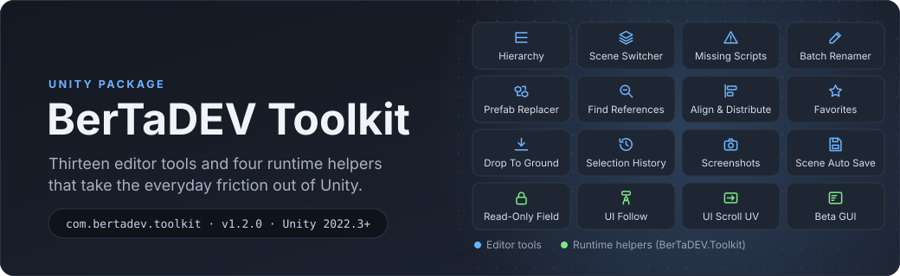
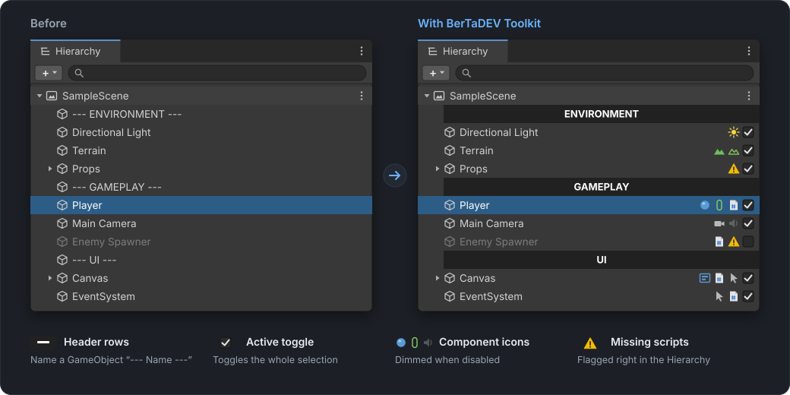
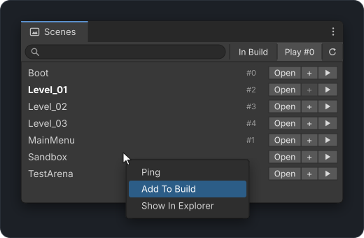
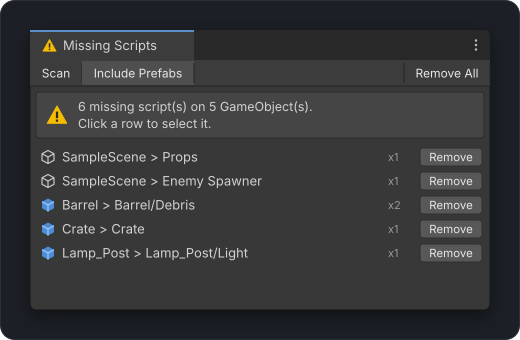
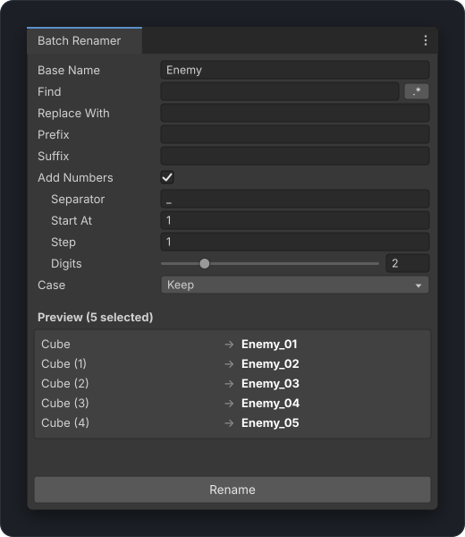
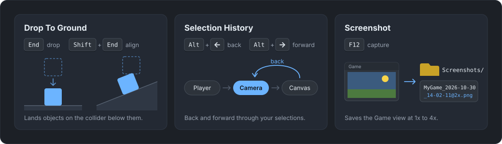
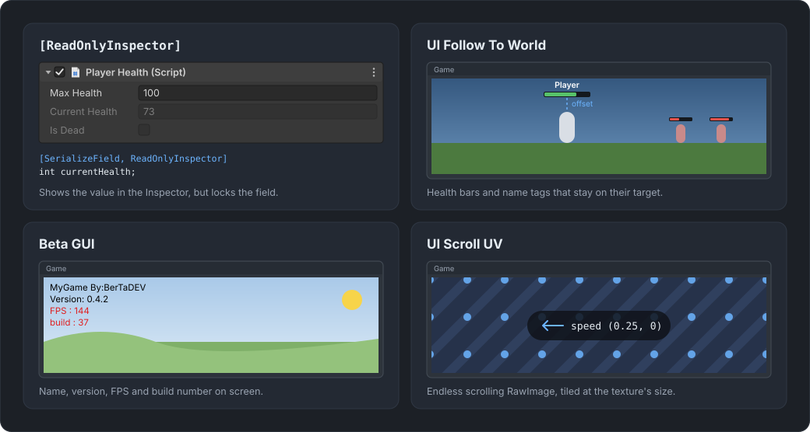

<p align="center">
  
</p>

# BerTaDEV Toolkit for Unity

Small tools that remove everyday friction in Unity, with no third-party dependencies. The editor tools are editor-only. The three [runtime helpers](#runtime-helpers) live in their own small assembly (`BerTaDEV.Toolkit`).

<p align="center">
  
</p>

| Tool | What it does | Where |
| --- | --- | --- |
| **Hierarchy Decorator** | Section headers (`--- Name ---`), an active checkbox and component icons on every row, optional zebra rows | Automatic. *GameObject > BerTaDEV > Hierarchy Header* |
| **Scene Switcher** | Every scene in the project in one searchable list: open, open additively, or play with one click. Right-click to add/remove from the build list | *Tools > BerTaDEV > Scene Switcher* |
| **Play From First Build Scene** | Play Mode always starts from build scene #0, and you come back to the scenes you were editing | *Tools > BerTaDEV > Play From First Build Scene* |
| **Missing Script Finder** | Finds "Missing (Mono Script)" components in open scenes, Prefab Mode and every prefab under `Assets/`, and removes them | *Tools > BerTaDEV > Missing Script Finder* |
| **Batch Renamer** | Rename many GameObjects or assets at once: find/replace (regex), prefix/suffix, numbering, case, live preview, undo | *Tools > BerTaDEV > Batch Renamer* |
| **Drop To Ground** | Drops the selection onto the collider below it. `Shift+End` also rotates it to match the surface | `End` / `Shift+End` |
| **Selection History** | Back and forward through what you selected, like a browser | `Alt+Left` / `Alt+Right` |
| **Screenshot** | Saves the Game view to `<Project>/Screenshots`, 1x to 4x resolution | `F12` |
| **Scene Auto Save** | Saves modified scenes every N minutes (off by default, per project) | *Edit > Preferences > BerTaDEV Toolkit* |

All options live in **Edit > Preferences > BerTaDEV Toolkit**. Every shortcut can be changed in **Edit > Shortcuts** (search for "BerTaDEV").

## A closer look

<p align="center">
  
  
</p>

**Scene Switcher** (left): click a name to ping it, *Open* / *+* / *▶* to open, add or play. Right-click a row to add it to or remove it from the build. **Missing Script Finder** (right): scene objects and prefab assets in one list, removable one by one or all at once.

<p align="center">
  
</p>

**Batch Renamer**: the preview updates as you type, and numbering follows the order you see in the Hierarchy (or the Project window for assets).

<p align="center">
  
</p>

## Runtime helpers

<p align="center">
  
</p>

| Helper | What it does | How |
| --- | --- | --- |
| **`[ReadOnlyInspector]`** | Shows a serialized field greyed out so you can watch it but not edit it. Structs stay expandable | Put it on a field |
| **UI Follow To World** | Keeps a UI element (health bar, name tag, marker) over a world object, with an offset. Hides it while the target is behind the camera | *Add Component > BerTaDEV > UI Follow To World* |
| **Beta GUI** | Corner overlay with product and company name, version, FPS and your own build number. Can be limited to Development Builds | *Add Component > BerTaDEV > Beta GUI* |

```csharp
using BerTaDEV.Toolkit;
using UnityEngine;

public class PlayerHealth : MonoBehaviour
{
    [SerializeField] int maxHealth = 100;
    [SerializeField, ReadOnlyInspector] int currentHealth;
}
```

**UI Follow To World** moves the element's anchors to the target's screen position, so put it on a UI element whose parent covers the whole screen and keep its *Pos X/Y* at 0. It uses `Camera.main` unless you assign a camera.

## Install

**Window > Package Manager > + > Add package from git URL...** and paste:

```
https://github.com/BerTaDev/bertadev-unity-toolkit.git
```

Or add this line to `Packages/manifest.json`:

```json
"com.bertadev.toolkit": "https://github.com/BerTaDev/bertadev-unity-toolkit.git"
```

To pin a version, add `#v1.1.0` to the end of the URL.

Requires Unity 2022.3 or newer. Built and tested on Unity 6.3.

## Notes

- **Hierarchy headers** are plain empty GameObjects whose name starts with `---`. They're tiny, but they do exist at runtime; keep gameplay objects out of them if you don't want them parented to an empty.
- **Drop To Ground** uses physics raycasts, so the ground needs a collider (planes, terrains and imported meshes with "Generate Colliders" have one).
- **Screenshot** captures on the Game view's next render. If the Game view is hidden behind another tab, it will be brought up.
- **Missing Script Finder** can undo scene changes. Prefab assets are saved directly, so it asks first.

## Türkçe

Unity'de her gün uğraştığın küçük işleri hızlandıran araçlar. Editör araçları sadece editörde çalışır; üç runtime yardımcısı ayrı bir assembly'de (`BerTaDEV.Toolkit`).

- **Hiyerarşi**: `--- İsim ---` diye adlandırdığın objeler başlık olur; her satırda aktif/pasif kutusu ve component ikonları.
- **Scene Switcher**: Projedeki tüm sahneler tek listede; tek tıkla aç, ekle ya da oynat.
- **Play From First Build Scene**: Play'e her zaman ilk build sahnesinden gir.
- **Missing Script Finder**: Sahnelerde ve prefablarda kayıp script'leri bulur, siler.
- **Batch Renamer**: Toplu yeniden adlandırma (bul/değiştir, regex, önek/sonek, numaralandırma, önizleme, geri al).
- **Drop To Ground**: `End` ile seçili objeleri yere indir, `Shift+End` ile yüzeye hizala.
- **Selection History**: `Alt+Sol` / `Alt+Sağ` ile seçim geçmişinde gez.
- **Screenshot**: `F12` ile Game view ekran görüntüsü (1x-4x).
- **Scene Auto Save**: Sahneleri belirli aralıklarla otomatik kaydet (varsayılan kapalı).

Runtime yardımcıları (`using BerTaDEV.Toolkit;`):

- **`[ReadOnlyInspector]`**: Alanı Inspector'da gösterir ama düzenlenemez yapar (gri). Struct'lar açılabilir kalır.
- **UI Follow To World**: Can barı, isim etiketi gibi UI elemanlarını dünyadaki bir objenin üstünde tutar; obje kameranın arkasındayken gizler.
- **Beta GUI**: Köşede oyun adı, şirket, versiyon, FPS ve build numarası gösterir. İstersen sadece Development Build'lerde.

Kurulum: Package Manager > + > *Add package from git URL* > `https://github.com/BerTaDev/bertadev-unity-toolkit.git`

## License

[MIT](LICENSE.md)
